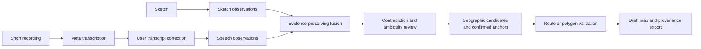

# Proposed architecture

## Shared core and distinct responsibility

Use the Drawn to Scale stack and run infrastructure: React/TypeScript/Vite, FastAPI/Pydantic, MapLibre, local-coordinate geometry, SQLite run/event storage and a bounded worker. Add a speech adapter, evidence fusion and a strict draft-boundary validator. Share code only after the mapping probe works; the folders remain independent planning alternatives.

## Meta roles and verification boundaries

The proposed speech adapter uses `muse-voice-transcribe-1.0`; the [official guide](https://dev.meta.ai/docs/speech-to-text) documents prerecorded upload and turn timestamps. Verify actual endpoint schema, language and file format in the smoke test. Speech accuracy on our names is **UNVERIFIED**.

`muse-spark-1.3` interprets sketch and corrected transcript into [schema-bound observations](https://dev.meta.ai/docs/structured-output), then proposes correspondences from allowed candidate IDs. It must retain source disagreement. The application enforces candidate existence, coordinate bounds, relation grammar, evidence IDs and confirmation state. The model does not adjudicate property rights or invent exact positions.

A two-pass extraction/fusion design permits ablation: sketch only, transcript only and combined receive the same area/candidate context and comparable call budgets. Report latency and usage as well as accuracy; extra calls must justify themselves.

## Contracts

| Entity | Required behavior |
|---|---|
| Observation | ID, modality, source region/turn, entity reference, predicate, value, original wording; immutable |
| TranscriptEdit | previous version, edited text, user provenance; invalidate downstream results |
| FusionProposal | entity links and supporting observation IDs; conflicting values retained as alternatives |
| Clarification | specific conflicting/unknown IDs, question and explicit answer; no implicit agreement |
| Anchor | source candidate ID or explicit human pin, coordinate reference system, status and evidence |
| DraftBoundary | ordered vertex IDs, confirmation state, closure state, area in projected units, validation errors |

No modality is automatically more authoritative. Only an explicit correction can supersede an earlier observation, and the audit history remains. New utterances do not silently overwrite old coordinates. Validate coordinates and constraints independently from the model output.

## Geographic and polygon checks

Reuse area-limited candidate retrieval and attribution rules from the mapping core. Compute in local projected metres. Validate distinct vertices, orientation-independent nonzero area, segment crossings, reasonable area bounds for the chosen region, and revision freshness. Report 'insufficient evidence' for missing anchors. Polygon validity tests shape consistency only; they do not establish that the described land exists at those coordinates.

Use [Shapely](https://shapely.readthedocs.io/en/stable/manual.html) for production geometry validity and [pyproj](https://pyproj4.github.io/pyproj/stable/) for coordinates. Keep a small independent hand-checked fixture set. The local probe implements only a deliberately limited validator to test the design assumptions before adopting dependencies.

## Runtime and UI

Add transcribing and resolving_conflicts stages to the shared run state machine. Recording/upload remains server-mediated; API keys never enter the browser. Preserve turn-level evidence and delete source media with the run when requested. Reuse upload limits, bounded calls, timeouts, interrupted-run handling and request access tokens from the base architecture.

The initial UI adds a transcript panel and a contradiction queue beside sketch/map views. The user can correct a proper noun, choose a candidate, or leave a feature unresolved. Final output must distinguish place/route observations from draft boundary geometry. No general-purpose chat thread is required.
